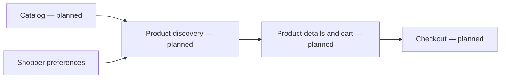

# SmartCart AI — Intelligent Shopping Concept

<strong>An e-commerce project concept focused on product discovery, comparison, and a responsive shopping flow.</strong>

## Intended experience

The project description proposes smart product search and checkout. A useful implementation should make product details, prices, availability, and checkout state clear, and should explain what personalization uses.

## Conceptual workflow

This is a conceptual product flow. The repository currently contains the project description and license, but no application source, install steps, or runnable demo.

## Before presenting it as runnable

Add the client/server implementation, test purchase and error flows, and document payment-provider and customer-data handling. Do not imply that checkout is active until it has been implemented and verified.
